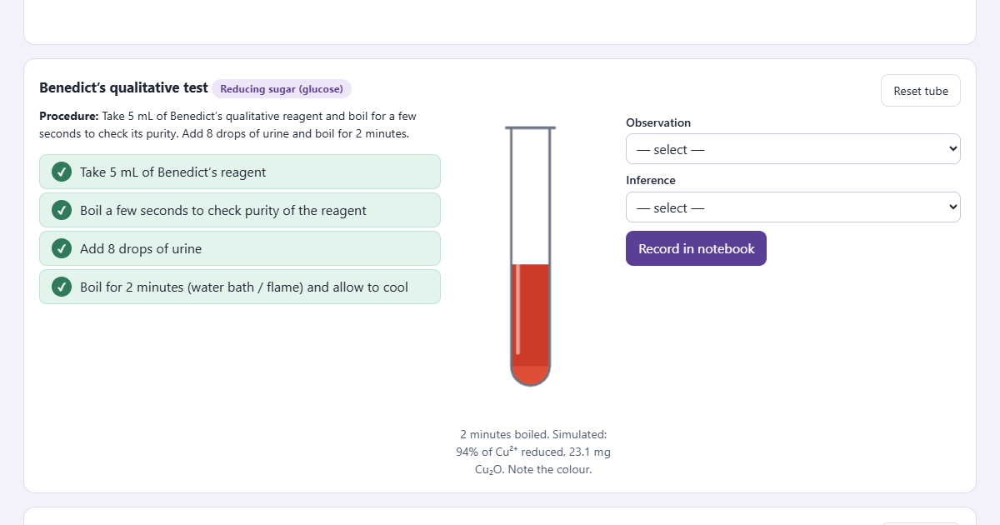

# Virtual Urine Lab: Experiment 10, Qualitative Analysis of Abnormal Urine

**Open the lab (v3.0, current):** https://chickerursr.github.io/virtual-urine-lab/Virtual-urine-labv3.0/

v3.0 applies the department's second round of corrections: urinometer scale in 0.002 divisions and calibrated at 20 °C, Rothera's "small amount" inference removed, an interpretation box for each case, dipstick removed, total marks 20, and a new Clinical significance section. See [Virtual-urine-labv3.0/README.md](Virtual-urine-labv3.0/README.md).

**Previous version (v2.0):** https://chickerursr.github.io/virtual-urine-lab/Virtual-urine-labv2.0/

v2.0 applies the Department of Biochemistry's first corrections and adds spoken instructions for every step, roll number and marks in a PDF report. See [Virtual-urine-labv2.0/README.md](Virtual-urine-labv2.0/README.md) for the list of changes.

**Original lab (v1):** https://chickerursr.github.io/virtual-urine-lab/ (described below)

It runs in any modern browser, on a laptop or a phone. There is nothing to install and no login. Each visitor's progress stays in their own browser.

## What this is

A virtual wet bench for Experiment 10 of the MBBS Biochemistry journal (JN Medical College, KAHER). It follows the journal's own two case reports and procedures:

| Case | Patient | What the urine shows |
|---|---|---|
| Case report 1 | John, 8 years: facial puffiness, reddish urine, BP 140/90 | Protein (heat coagulation, SSA), blood (benzidine), oliguria, smoky red, raised SG: acute glomerulonephritis |
| Case report 2 | 50-year-old diabetic woman in coma, Kussmaul breathing | Reducing sugar (Benedict's brick red), ketone bodies (Rothera's ring), polyuria, pale urine with high SG: diabetic ketoacidosis |

The goal is a virtual lab **whose results can be checked against the real wet lab**, tube by tube. Students can rehearse and explore on the laptop. Faculty and clinicians can see that the simulation agrees with the bench before relying on it.

## Why the simulation and the wet lab should agree

No result is typed in as an answer. Each sample is defined by what it contains (albumin mg/dL, red cells per µL, glucose %, acetoacetate mg/dL, pH …). Each test is then **simulated from its chemistry**:

| Test | What is simulated |
|---|---|
| Benedict's | Glucose enolisation with temperature-dependent (Arrhenius) rates, Cu²⁺ → Cu₂O stoichiometry, colour from the remaining copper and the Cu₂O particles |
| Heat coagulation + acetic acid | Albumin denaturation kinetics, pH after acid (charge balance cross-checked with USGS PHREEQC), isoelectric aggregation, phosphate turbidity that clears in acid |
| Sulphosalicylic acid | Protein precipitation; turbidity linear in protein |
| Rothera's | Ammonia diffusing into the ammonium-sulphate-saturated urine; the nitroprusside complex forms where pH > 8.6, which makes the ring; β-hydroxybutyrate does not react |
| Hay's | Surface tension (Szyszkowski equation); sulphur sinks below ≈ 55 mN/m |
| Fouchet's | Bilirubin adsorbed on BaSO₄ and oxidised to green biliverdin |
| Benzidine | Haem peroxidase kinetics; time to visible colour |
| Dipstick | Indicator chemistry of each pad, with development time (read at 40 s – 2 min) |

Every colour on screen is computed from the light absorption of the sample (Beer–Lambert law, then CIE colour matching), not picked by hand.

## How to compare with the wet lab

1. **Prepare the samples.** The **Faculty · Wet-lab match** tab gives a recipe per 100 mL of pooled normal urine. In short:
   - **Case 1:** pooled first-morning urine (SG ≈ 1.025) with 150 mg albumin and 0.2 mL fresh EDTA blood, adjusted to pH 6.0.
   - **Case 2:** urine diluted 1 + 1, with 3.0 g glucose, 0.04 mL acetone, 0.1 mL ethyl acetoacetate and salt to SG ≈ 1.032, at pH 5.0.
2. **Run the journal procedure** in the wet lab and on the laptop, side by side.
3. **Compare** test by test: positive / negative and colour grade. This is the primary check.
4. **Measure** what the **Verify in lab** tab predicts and enter it:
   - Cu₂O mass (filter, dry, weigh)
   - A₆₀₀ after SSA or heat (colorimeter)
   - seconds until the Rothera's ring or benzidine colour appears (stopwatch)
   - stalagmometer drop count, urinometer reading
   - tube colours (photograph vs rendered colour)

   Each value is marked *agrees* or *differs* with a stated tolerance.
5. **Calibrate if needed.** If a bench differs, **Fit** re-fits one constant from that measurement, and every prediction updates. A printable **standards series** checks the model over its whole range: glucose 0–3 %, albumin 0–300 mg/dL, acetoacetate, bile salts, haemoglobin and bilirubin dilutions.

## What has been verified, and what has not

- **Automated tests:** 27 answer-key checks for both cases, and 24 chemistry checks (reaction kinetics, equilibria, colour order, agreement with PHREEQC, calibration round-trip). Run them with `node tests/engine.test.cjs` and `node tests/reactions.test.cjs`.
- **Open-source cross-check:** the pH after glacial acetic acid was computed independently with **USGS PHREEQC** ([opensource_sim/phreeqc_check.py](opensource_sim/phreeqc_check.py)). The lab model agrees within 0.02 pH units (RMS) over urine pH 5–7 and 0–30 drops.
- **Not yet verified:** the constants are published literature values. Agreement with a real bench (our reagents, drop size and flame) is what the wet-lab comparison above is designed to establish.

No open-source simulator for qualitative urinalysis exists, so the kinetics and colour models are this project's own.

## Using it

| Who | How |
|---|---|
| Students | Tabs 1–5: case and specimen → physical exam (incl. urinometer temperature correction) → the seven chemical tests step by step → timed dipstick → report in the journal format (prints) |
| Faculty | **Faculty** tab: recipes, answer key, detection limits, and a custom-sample builder to design unknowns and see the predicted wet-lab result |
| Anyone | **Reaction simulator**: change heating time and mode, drops of acid, observation time; see the concentration curves, spectrum and outcome |

Run it offline: download the repository and double-click `index.html`.

## Files

| File | Contents |
|---|---|
| `index.html`, `app.js` | the virtual bench |
| `reactions.js` | reaction models, colour engine, predicted measurables, calibration |
| `engine.js` | case data, wet-lab recipes, grading, dipstick |
| `reactlab.js` | Reaction simulator and Verify in lab tabs |
| `tests/` | automated tests (Node.js) |
| `opensource_sim/` | PHREEQC cross-check script and its results |

## Licence

Released under the **[PolyForm Noncommercial License 1.0.0](LICENSE.md)**.

- **Free** for any noncommercial purpose: teaching, learning, research and personal study. This covers use by any educational institution, public research organisation, or public health or government body, which may also copy and adapt it.
- **Commercial use** (for example including it in a paid product or service) needs written permission from the author. Please get in touch through this repository.

Required Notice: Copyright (c) 2026 Satyadhyan Chickerur (https://github.com/chickerursr/virtual-urine-lab)

The two case reports and the experiment procedures follow the MBBS Biochemistry Journal of the Department of Biochemistry, Jawaharlal Nehru Medical College, KAHER, Belagavi. They are acknowledged here and remain the property of their owners; the licence above covers this project's own code and content.

## Note

For medical education. Results are model predictions, meant to be compared with the wet lab, and are not for clinical decisions. The ancillary blood values in the case tab are illustrative. Benzidine is a carcinogen: in the wet lab use gloves and a fume hood, or the substitute your department prescribes.

Built by **Prof. Satyadhyan Chickerur**, Centre for AI Research, KLE Technological University, Hubballi, for the Department of Biochemistry, Jawaharlal Nehru Medical College, KAHER, Belagavi.
